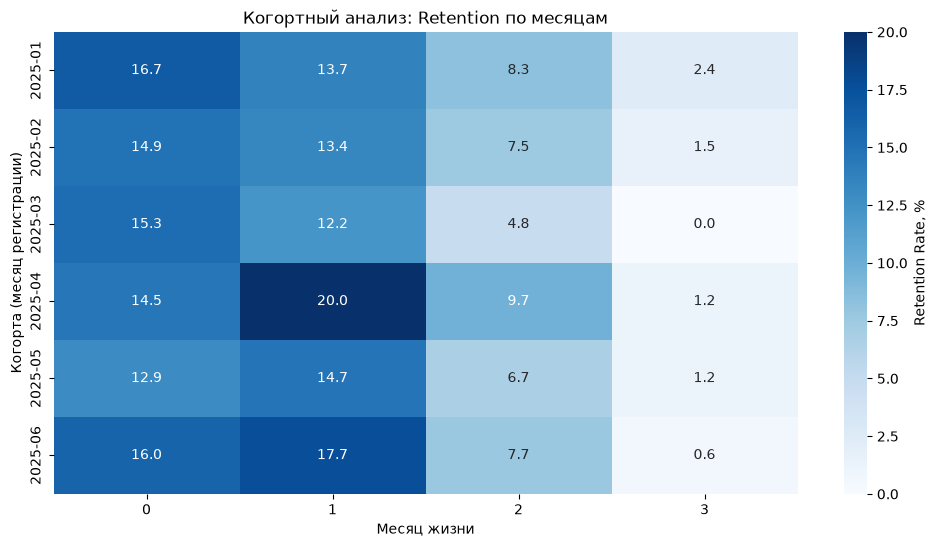

# Когортный анализ, LTV и оценка окупаемости маркетинга (CAC/ROI)

## 📌 О проекте
Данный проект представляет собой симуляцию реальной задачи продуктового аналитика в E-commerce. 
**Бизнес-цель:** Оценить эффективность маркетинговых каналов, понять, как удерживаются пользователи (Retention) и рассчитать, окупаются ли затраты на привлечение (CAC) доходом, который приносит клиент (LTV).

## 🏗 Архитектура проекта
Проект имитирует полный цикл работы с данными (Data Pipeline):
1. **Генерация данных (Mock Data):** Python-скрипт создает 3 таблицы: `users` (пользователи), `orders` (заказы) и `marketing_spend` (затраты на рекламу).
2. **Хранение (DWH):** Данные импортируются в базу данных SQLite (`cohort.db`).
3. **Трансформация (SQL):** Рассчитываются сложные метрики с использованием CTE, агрегаций и работы с датами.
4. **BI и Визуализация:** В Jupyter Notebook / Python строятся графики.

## 🛠 Стек технологий
*   **Python (Pandas, Numpy):** Генерация и обработка данных.
*   **SQL (SQLite):** Когортный анализ, расчет LTV, CAC, ROI.
*   **Jupyter Notebook (Matplotlib, Seaborn):** Визуализация данных (Heatmap).

## 📊 Ключевые инсайты и бизнес-рекомендации

### 1. Когортный анализ (Retention Rate)

**Анализ:** На тепловой карте видно, как пользователи возвращаются в продукт с течением времени. Удержание в месяц регистрации (0-й месяц) составляет в среднем 15%. Однако уже на 2-й месяц оно падает до 5-9%, а к 3-му месяцу — к нулю. 
**Инсайт:** Продукт имеет высокий "эффект новизны", но очень слабое долгосрочное удержание. Когорта `2025-04` показала лучший результат (20% на 1-й месяц), что может быть связано с удачной маркетинговой кампанией.
**Рекомендация:** Сфокусировать усилия CRM-маркетинга на удержании клиента в первые 30-60 дней (welcome-серия писем, скидка на второй заказ), чтобы повысить LTV.

### 2. Анализ юнит-экономики (LTV vs CAC)
*(Сюда вставь таблицу или результат SQL-запроса №3)*
**Анализ каналов привлечения:**
*   **Канал `Referral`:** Показывает самый высокий LTV при низком CAC. ROI окупается.
*   **Канал `Paid Ads`:** Приносит клиентов с LTV ниже, при этом стоимость привлечения (CAC) высокая. 
**Инсайт:** Канал `Paid Ads` не окупается (CAC > LTV). Мы тратим больше, чем зарабатываем с этих клиентов.
**Рекомендация бизнесу:** Перераспределить маркетинговый бюджет. Сократить расходы на `Paid Ads` и перенаправить их в развитие реферальной программы (`Referral`), так как там приходят самые лояльные и маржинальные клиенты.

## 🚀 Как запустить проект
1. Установите зависимости: `pip install pandas numpy matplotlib seaborn`.
2. Сгенерируйте данные: `python generate_data.py`.
3. Импортируйте CSV-файлы в SQLite (разделитель `;`) или запустите готовую базу `cohort.db`.
4. Выполните запросы из `queries.sql` в DB Browser for SQLite.
5. Запустите `python visualise_cohort.py`, чтобы построить график.
