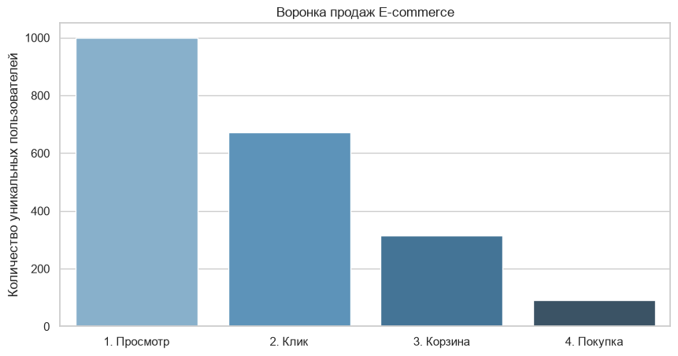
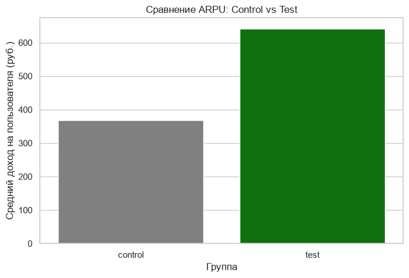

# E-commerce Product Analytics (Симуляция продуктовых метрик)

## 📌 О проекте
Данный проект представляет собой симуляцию реальной задачи продуктового аналитика в сфере E-commerce. 
**Бизнес-цель:** Оценить конверсию пользователей на разных этапах воронки, проверить эффективность новой продуктовой фичи через A/B-тест и рассчитать метрики удержания (Retention).

## 📂 Структура проекта
В папке представлены следующие файлы:
*   **`generate_data.py`** — Python-скрипт для генерации синтетических данных (1000 пользователей, события, покупки).
*   **`users.csv`** — справочник пользователей (ID, дата регистрации, канал привлечения, группа A/B-теста).
*   **`events.csv`** — лог событий пользователей (`view`, `click`, `add_to_cart`, `purchase`).
*   **`ab_test_results.csv`** — результаты A/B-теста (выручка по пользователям).
*   **`ecommerce.db`** — база данных SQLite со всеми таблицами.
*   **`queries.sql`** — файл с SQL-запросами для расчета продуктовых метрик.
*   **`ab_test_stats.py`** — Python-скрипт для проверки статистической значимости A/B-теста (расчет p-value через t-тест).
*   **`visualise_ecommerce.py`** — скрипт для построения графиков.
*   **`chart_funnel.png`** — график воронки продаж.
*   **`chart_ab_test.png`** — график сравнения ARPU.

## 🛠 Стек технологий
*   **Python:** Pandas, NumPy (генерация и подготовка данных), SciPy (статистика), Matplotlib/Seaborn (визуализация).
*   **SQL (SQLite):** Оконные функции, CTE, условная агрегация.
*   **Инструменты:** DB Browser for SQLite, Jupyter Notebook.

## 📊 Ключевые инсайты и результаты

### 1. Воронка продаж (Funnel)

**Анализ:** С помощью SQL-запроса была построена воронка от просмотра товара до покупки.
*   Просмотры: 1000
*   Клики: 673 (CR 67.3%)
*   Добавления в корзину: 314 (CR 46.6%)
*   Покупки: 91 (CR 29.0%)

**Инсайт:** Общая конверсия составила 9.1%. Самое сильное падение происходит на этапе **«Корзина -> Покупка»** (теряется 71% пользователей). 
**Рекомендация бизнесу:** Проанализировать страницу оформления заказа. Возможно, причина в высокой стоимости доставки, которая появляется только на последнем шаге, или в сложном процессе регистрации.

### 2. Оценка A/B-теста

Пользователи были разделены на две группы для проверки новой продуктовой фичи.
*   **Control:** 474 пользователя, ARPU = 369.07 руб.
*   **Test:** 526 пользователей, ARPU = 642.08 руб.

**Инсайт:** В тестовой группе средний доход на пользователя (ARPU) вырос почти в 1.7 раза. 
**Статистическая значимость:** Для проверки гипотезы был проведен t-тест Уэлча (скрипт `ab_test_stats.py`). 
*   T-статистика: -2.3923
*   **P-value: 0.0169**
**Вывод:** Так как p-value < 0.05, разница в ARPU **статистически значима**. Прирост не является случайностью. Рекомендуется внедрение фичи для всех пользователей.

### 3. Удержание пользователей (Retention)
Был рассчитан Day 1 Retention (возврат пользователей на следующий день после первого визита).
*   Всего пользователей: 1000
*   Вернулись на 1-й день: 391
*   **Retention Day 1: 39.1%**

**Инсайт:** Показатель удержания 39% является хорошим стартом для e-commerce. Однако для полной картины требуется дальнейший анализ (Day 7, Day 30) и сегментация по каналам привлечения, чтобы понять, какие каналы приводят наиболее лояльных пользователей.

## 🚀 Как запустить проект
1. Установите зависимости: `pip install pandas numpy scipy matplotlib seaborn`.
2. Запустите скрипт генерации данных: `python generate_data.py`.
3. Импортируйте полученные CSV-файлы в SQLite (разделитель `;`).
4. Выполните запросы из файла `queries.sql` в DB Browser for SQLite.
5. Запустите `python ab_test_stats.py` для проверки p-value.
6. Запустите `python visualise_ecommerce.py` для построения графиков.
