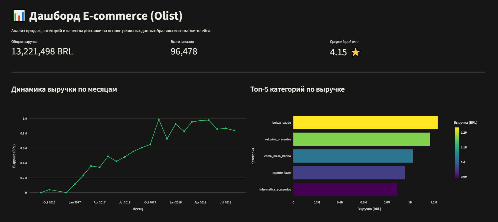
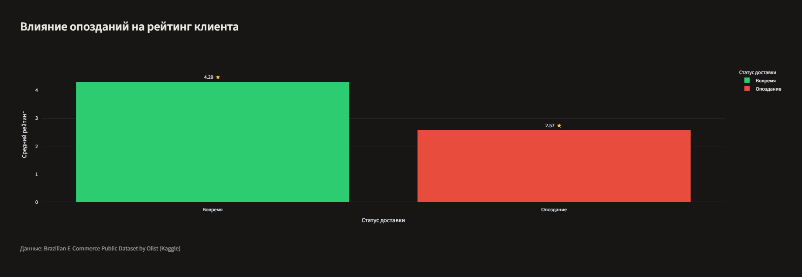

# Анализ E-commerce данных (Brazilian Olist Dataset)

## 📌 О проекте
Проект демонстрирует анализ реальных данных крупнейшего бразильского маркетплейса Olist. 
**Бизнес-цель:** Оценить выручку, выявить сезонность, сегментировать клиентов (RFM), проанализировать топовые категории товаров и оценить влияние логистики на удовлетворенность клиентов (отзывы).

## 📂 Структура проекта
*   **`data/`** — папка с исходными данными (ссылка на Kaggle и Я.Диск в описании).
*   **`olist.db`** — база данных SQLite с 6+ связанными таблицами (На Я.Диске).
*   **`queries.sql`** — SQL-запросы для расчета метрик.
*   **`dashboard.py`** — код интерактивного дашборда на Streamlit.
*   **`chart_*.png`** — скриншоты дашбордов и ключевых графиков.

## 🛠 Стек технологий
*   **SQL (SQLite):** JOIN (6 таблиц), CTE, оконные функции (`RANK`), RFM-сегментация.
*   **Python (Pandas):** Обработка данных, подготовка витрин.
*   **Streamlit + Plotly:** Интерактивный дашборд.

## 📊 Интерактивный дашборд

Для визуализации данных я разработала интерактивный дашборд на Streamlit. Он позволяет в реальном времени отслеживать ключевые метрики бизнеса.

### Ключевые выводы из дашборда:
*   **Выручка:** Наблюдается устойчивый рост выручки с пиком в ноябре 2017 года (сезон распродаж). 
*   **Категории:** Основную выручку приносят категории `bed_bath_table` (товары для дома), `health_beauty` и `sports_leisure`.
*   **Логистика (график ниже):** Заказы, доставленные вовремя, имеют средний рейтинг **4.29**, в то время как опоздавшие заказы получают **2.57**. Логистика напрямую влияет на лояльность клиентов.

## 🚀 Как запустить проект
1. Установите зависимости: `pip install pandas sqlite3 streamlit plotly`.
2. Скачайте датасет по ссылке на Kaggle (или распакуйте архив).
3. Импортируйте CSV в SQLite (база `olist.db` уже готова в репозитории).
4. Запустите дашборд: `streamlit run dashboard.py`.
