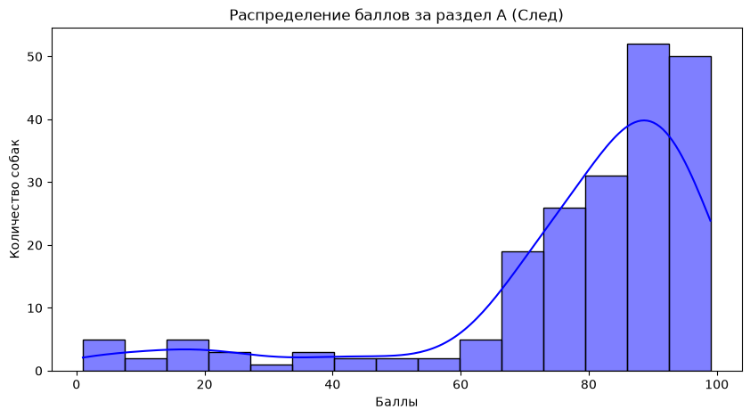

# Анализ данных кинологических соревнований (IGP)

## 📌 О проекте
Данный проект представляет собой исследовательский анализ данных соревнований по кинологическому спорту (IGP) за 2024-2026 годы. 
Цель анализа — выявить закономерности в результатах выступающих собак, сравнить успешность разных пород и проанализировать динамику результатов во времени.

## 📂 Структура проекта
В папке представлены следующие файлы:
*   **`dogbase.csv`** — справочник участников (ID собаки, кличка, порода, проводник, город).
*   **`champ.csv`** — результаты выступлений (баллы за разделы A, B, C, итоговый балл, оценка, год).
*   **`dogsdb.db`** — готовая база данных SQLite со всеми таблицами.
*   **`load_data.py`** — Python-скрипт для ETL-процесса (очистка данных и загрузка в базу SQLite).
*   **`visualise.py`** — Python-скрипт для построения графиков (Matplotlib/Seaborn).
*   **`queries.sql`** — файл с коллекцией SQL-запросов (JOIN, CTE, оконные функции).
*   **`chart_breeds.png`** — график "Топ-5 пород по среднему баллу".
*   **`chart_scores.png`** — график "Распределение баллов за След".

## 🛠 Инструменты
*   **Python (Pandas, Matplotlib, Seaborn)** — обработка и визуализация данных.
*   **SQL (SQLite)** — извлечение и агрегация данных.

## 📊 Запросы SQL
1. Топ 5 за 2026г
2. Как менялся средний итоговый балл и количество участников по годам?
3. Топ-3 собаки по итоговым баллам в каждом году
4. Динамика результатов собак (разница с предыдущим годом)
5. Собаки, с сильным следом (А) и защитой (С), но слабым послушанием (В)
6. Статистика по породам (средний балл, лучший балл, худший балл)
7. Самая перспективная порода в IGP
8. Кореляция следа и остальных разделов
9. Вывести всех собак чей результат от года к году упал на 10% и более
10. Вывести список от самых стабильных к менее стабильным по общему баллу
11. Собаки, которые набрали больше 280 баллов, имеют минимум 2 выступления на ЧР, при этом их средний балл в этом году выше среднего по их породе в этом же году.
12. Собаки, выступившие во все 3х годах

## 📊 Ключевые инсайты и визуализация

### 1. Самые успешные породы

**Вывод:** На основе данных за 3 года, наиболее перспективной породой для выступлений в IGP является **Бельгийская овчарка (Малинуа)**. Она показывает самый высокий средний балл. *Важно отметить:* при анализе был применен фильтр `HAVING COUNT >= 10`, чтобы исключить смещение выборки (Selection Bias) от пород с малым количеством выступлений (например, Доберман), которые могли исказить статистику.

### 2. Распределение оценок за След (Раздел А)

**Вывод:** Распределение баллов за След (А) имеет бимодальную форму. Большинство собак показывают высокие результаты (80–100 баллов), однако существует отдельная группа с результатами ниже 20 баллов. Это говорит о том, что в дисциплине "След" нет "середнячков": либо собака подготовлена отлично, либо полностью теряет след.

### 3. Динамика и аномалии (результаты SQL-запросов)
*   **Корреляция разделов:** Проверка гипотезы о связи Следа (А) и Защиты (С) показала, что прямой сильной связи нет. Собака может быть гением в следе, но провалить защиту.
*   **Динамика:** Анализ выявил собак с резким падением результатов от года к году (более чем на 30%). Это может быть связано с травмами, сменой подготовки или выгоранием.

## 🚀 Как запустить
1. Установите зависимости: `pip install pandas matplotlib seaborn`.
2. Запустите скрипт загрузки данных: `python load_data.py`.
3. Запустите скрипт визуализации: `python visualise.py`.
4. Откройте файл `queries.sql` в DB Browser for SQLite для просмотра запросов.
