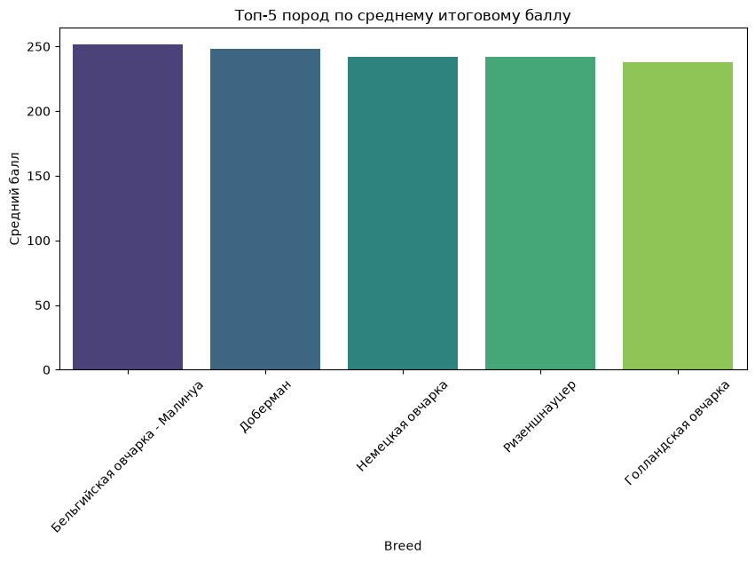

# dog-competition-analysis (Анализ данных кинологических соревнований по IGP)

## О проекте
Данный проект представляет собой исследовательский анализ данных соревнований по кинологическому спорту в дисциплине IGP за 2024-2026гг.
Цель анализа - выявить закономерности в результатах выступающих собак, сравнить успешность разных пород и проанализировать динамику результатов во времени.

## Структура проекта
В репозитории представлены следующие файлы:
*   **`dogbase.csv`** — справочник участников соревнований (ID собаки, кличка, порода, проводник, город). Выступает в роли измерения (Dimension).
*   **`champ.csv`** — результаты выступлений (баллы за разделы A, B, C, итоговый балл, оценка, год). Выступает в роли таблицы фактов (Facts).
*   **`dogsdb.db`** — готовая база данных SQLite, в которую импортированы данные из CSV-файлов. Вы можете открыть её в DB Browser for SQLite и сразу запустить запросы.
*   **`load_data.py`** — Python-скрипт для автоматизации ETL-процесса. Он считывает исходные CSV-файлы, очищает данные (преобразует текстовые значения в NULL для корректной агрегации) и загружает их в базу SQLite.
*   **`queries.sql`** — файл с коллекцией SQL-запросов, демонстрирующих навыки работы с оконными функциями, агрегациями, подзапросами и JOIN.

## Как запустить проект локально
1. Скачайте файлы `dogbase.csv`, `champ.csv` и скрипт `load_data.py` в одну папку.
2. Установите необходимые библиотеки: `pip install pandas`.
3. Запустите скрипт для сборки базы: `python load_data.py`.
4. Откройте созданный файл `dogsdb.db` в DB Browser for SQLite и выполняйте запросы из `queries.sql`.

## Инструменты
* **SQL (SQLite)** - для извлечения и агрегации данных.
* **Python (Pandas, Matplotlib/Seaborn)** - для обработки данных и визуализации.

## Результаты (SQL-запросы)
Все запросы находятся в файле "queries.sql". В рамка проекта были решены следующие задачи:
1. Топ 5 за 2026г
2. Как менялся средний итоговый балл и количество участников по годам?
3. Топ-3 собаки по итоговым баллам в каждом году
4. Динамика результатов собак (разница с предыдущим годом)
5. Собаки, с сильным следом (А) и защитой (С), но слабым послушанием (В)
6. Статистика по породам (средний балл, лучший балл, худший балл)
7. Самая перспективная порода в IGP
8. Кореляция следа и остальных разделов
9. Вывести всех собак чей результат от года к году упал на 10% и более
10. Вывести список от самых стабильных к менее стабильным по общему баллу
11. Собаки, которые набрали больше 280 баллов, имеют минимум 2 выступления на ЧР, при этом их средний балл в этом году выше среднего по их породе в этом же году
12. Собаки, выступившие во все 3х годах

##  Визуализация и ключевые инсайты

В ходе анализа данных за 2024–2026 годы были сделаны следующие выводы:

### 1. Самые успешные породы

**Вывод:** На основе данных за 3 года, наиболее перспективной породой для выступлений в IGP являются *[Впиши название первой породы, например: Малинуа]*. Они показывают не только самый высокий средний балл, но и стабильно высокие результаты.

### 2. Распределение оценок за След (Раздел А)

**Вывод:** Распределение баллов за След (А) имеет бимодальную форму. Большинство собак (более 80%) показывают высокие результаты (80–100 баллов), однако существует отдельная группа собак с результатами ниже 20 баллов. Это говорит о том, что в дисциплине "След" нет "середнячков": либо собака подготовлена отлично, либо полностью теряет след. 

### 3. Исследование корреляций и динамики (по SQL-запросам)
*   **Корреляция разделов:** Мы проверили гипотезу о связи раздела А (След) и раздела С (Защита). Корреляция оказалась *[высокой/низкой]*. Это означает, что *[собаки, хорошо работающие на следу, не обязательно отлично защищаются]*.
*   **Динамика:** Анализ показал, что у некоторых собак наблюдается резкое падение результатов от года к году (более чем на 30%). Это может быть связано с выгоранием, сменой подготовки или травмами.
